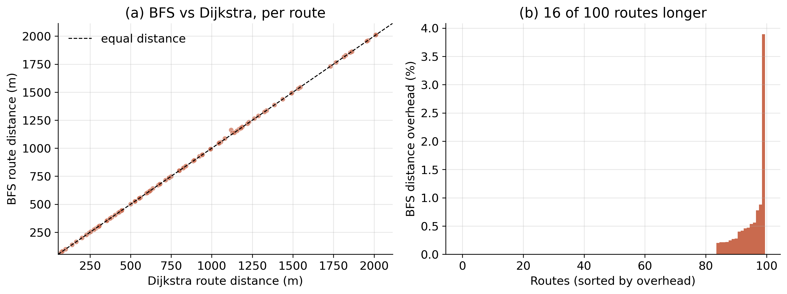
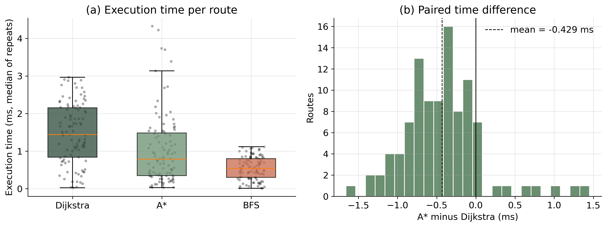
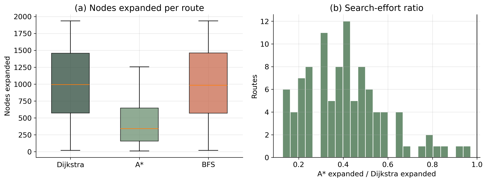
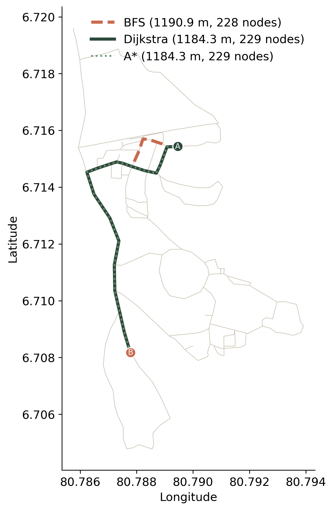
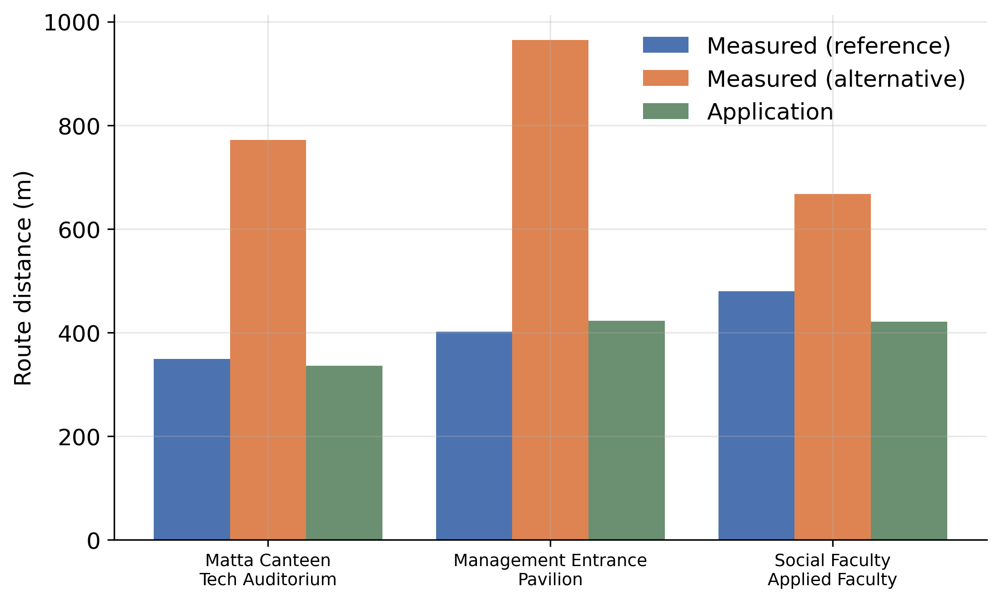

# Evaluating Shortest-Path Algorithms for Campus Navigation
### Computational Performance, Graph Topology, and Comparison with Measured Route Distances

[](https://www.python.org/downloads/)
[](https://fastapi.tiangolo.com/)
[](https://networkx.org/)
[](https://opensource.org/licenses/MIT)

> **Research Paper & Project Implementation**  
> **Author:** Kathuskan Thavarajah  
> **Institution:** Faculty of Computing, Sabaragamuwa University of Sri Lanka, Belihuloya, Sri Lanka  
> **Supervisor:** P. G. P. Kumara (Faculty of Computing)  
> **Physical Measurements:** Thillaivasan Manojkaran (Surveying Science programme, Faculty of Geomatics)  
> **Repository:** [https://github.com/Kathuskan/Quiky](https://github.com/Kathuskan/Quiky)

---

## Table of Contents

1. [Abstract](#abstract)
2. [Key Findings at a Glance](#key-findings-at-a-glance)
3. [Research Questions](#research-questions)
4. [Campus Network Construction & Topology](#campus-network-construction--topology)
5. [Algorithms Under Test](#algorithms-under-test)
6. [Experimental Methodology](#experimental-methodology)
7. [Comprehensive Benchmark Results](#comprehensive-benchmark-results)
   - [RQ1: Route Distance Optimality](#rq1-route-distance-optimality)
   - [RQ2: Execution Time and Search Effort](#rq2-execution-time-and-search-effort)
   - [RQ3: Path Agreement and Topological Constraints](#rq3-path-agreement-and-topological-constraints)
   - [Named Campus Locations Benchmark](#named-campus-locations-benchmark)
   - [RQ4: Supplementary Comparison with Physical Route Measurements](#rq4-supplementary-comparison-with-physical-route-measurements)
8. [Web Application & Architecture](#web-application--architecture)
9. [API Reference](#api-reference)
10. [Project Structure](#project-structure)
11. [Getting Started & Reproducibility](#getting-started--reproducibility)
12. [Limitations & Future Work](#limitations--future-work)
13. [Acknowledgements & Citation](#acknowledgements--citation)

---

## Abstract

Shortest-path algorithms are widely used in navigation applications, but their real-world outcomes depend heavily on both algorithmic design and the topological structure of the routing graph. This project develops an end-to-end pedestrian routing platform and empirically evaluates **Dijkstra’s algorithm**, **A\* search**, and **Breadth-First Search (BFS)** on a pedestrian routing network of the **Sabaragamuwa University of Sri Lanka (SUSL)** campus.

The network was digitized in Google My Maps, exported as a KMZ file, and densified into $\approx 5\text{ m}$ segments, yielding **1,953 nodes**, **1,977 edges**, **2 connected components**, and **26 independent cycles**. Custom single-direction implementations of all three algorithms were validated against NetworkX and benchmarked on 100 randomly sampled connected origin–destination (OD) pairs and 100 pairs between named campus locations under controlled, randomized timing repetitions.

Key outcomes demonstrate that:
- **Dijkstra’s algorithm and A\*** returned **100% identical routes and distances** (mean route distance: $860.12\text{ m}$), confirming the heuristic's admissibility and consistency.
- **A\* reduced search effort by 54.8%** (mean $451.6$ vs. $999.0$ expanded nodes, $p < 0.001$), but reduced execution time by only **29.3%** ($1.04\text{ ms}$ vs. $1.47\text{ ms}$) due to the trigonometric computation overhead of evaluating the Haversine heuristic at each node expansion ($2.30\ \mu\text{s}$ vs. $1.47\ \mu\text{s}$ per expanded node).
- **BFS achieved the lowest execution time** ($0.55\text{ ms}$) despite expanding approximately the same number of nodes ($998.5$ nodes, $p = 0.147$), because its FIFO queue requires neither priority queue operations nor floating-point weight arithmetic ($0.55\ \mu\text{s}$ per node). However, BFS produced longer routes on 16% of pairs (up to $3.89\%$ distance overhead).
- **Graph topology governs route divergence:** All 16 route disagreements occurred exclusively on edges belonging to cycles (non-bridges). On bridge edges, only one simple path exists, ensuring algorithm agreement.
- **A supplementary comparison** with total station survey measurements ($\pm 1\text{ mm}$ accuracy) for 3 campus journeys revealed a mean absolute percentage error (MAPE) of **7.10%**, emphasizing the role of coordinate snapping, digitisation accuracy, and ground-truth validation.

---

## Key Findings at a Glance

| Metric | Dijkstra's Algorithm | A\* Search (Haversine) | Breadth-First Search (BFS) |
|---|:---:|:---:|:---:|
| **Mean Execution Time** | $1.4671\text{ ms}$ | $1.0377\text{ ms}$ *(29.3% faster)* | $\mathbf{0.5471\text{ ms}}$ *(62.7% faster)* |
| **Median Execution Time** | $1.4388\text{ ms}$ | $0.7829\text{ ms}$ | $\mathbf{0.5384\text{ ms}}$ |
| **Mean Nodes Expanded** | $999.0\text{ nodes}$ | $\mathbf{451.6\text{ nodes}}$ *(54.8% fewer)* | $998.5\text{ nodes}$ *(no stat. diff)* |
| **Mean Route Distance** | $\mathbf{860.12\text{ m}}$ | $\mathbf{860.12\text{ m}}$ *(identical)* | $861.24\text{ m}$ *(+1.13 m excess)* |
| **Distance Optimality** | Guaranteed Optimal | Guaranteed Optimal | Sub-optimal on 16% of pairs (max +3.89%) |
| **Path Agreement (Jaccard)**| $1.0000$ (Reference) | $1.0000$ (100/100 identical) | $0.9153$ (84/100 identical) |
| **Time per Expanded Node** | $1.4685\ \mu\text{s}$ | $2.2976\ \mu\text{s}$ *(heuristic overhead)* | $\mathbf{0.5479\ \mu\text{s}}$ *(no priority queue)* |

---

## Research Questions

The study formally evaluates four research questions:

- **RQ1: Route Distances:** How do the route distances returned by Dijkstra’s algorithm, A\*, and BFS compare on the campus network?
- **RQ2: Computational Performance:** How do the execution times and the numbers of expanded nodes of the three algorithms differ across matched origin–destination pairs?
- **RQ3: Topological Influence:** How often do the algorithms return different paths, and how does the topology of the campus graph (cycles vs. bridges) constrain such differences?
- **RQ4: Physical Accuracy:** How do the distances of application-generated routes compare with independently measured distances for selected campus journeys?

---

## Campus Network Construction & Topology

### 1. Spatial Digitisation & Map Processing
Walkways across the Sabaragamuwa University of Sri Lanka campus were traced using **Google My Maps** and exported as a Keyhole Markup Language Zipped (`.kmz`) archive (`SABRA.kmz-2`, SHA-256: `bea61e136c05cf6437c3c99b7f9ed53aaf74f7b2a4aed7f7ecb1aa1cb62b172e`). LineString coordinates and Placemark landmarks were extracted via Python XML parsing.

### 2. Network Densification
To provide fine spatial resolution for map snapping and interactive routing, every traced segment of length $L$ was subdivided into $\max(1, \lfloor L / 5\text{ m} \rfloor)$ equal sub-segments:
- Resulting edge lengths range between **$1.20\text{ m}$ and $9.85\text{ m}$** (median: **$5.18\text{ m}$**).
- Edge weights were calculated using the Haversine great-circle formula with Earth radius $R = 6,371,000\text{ m}$.
- Densification adds intermediate sampling points along traced lines without creating artificial cross-connections.

### 3. Graph Topological Properties

```
Campus Graph G = (V, E)
├── Total Nodes (|V|): 1,953
├── Total Edges (|E|): 1,977
├── Connected Components: 2
│    ├── Component 1 (Main Network): 1,947 nodes, 1,972 edges
│    └── Component 2 (Isolated Fragment): 6 nodes, 5 edges
├── Cyclomatic Number (Independent Cycles): 26  (E - V + C = 1977 - 1953 + 2)
├── Non-bridge Edges (Cycle edges): 1,639 (82.9%)
└── Bridge Edges (Cut edges): 338 (17.1%)
```

### 4. Mathematical Constraint of Topology on Route Divergence
- **Bridge Edges:** A bridge edge is a cut edge whose removal increases the number of connected components. Any route traversing only bridges has **exactly one simple path**. Therefore, Dijkstra, A\*, and BFS **must return identical paths** on bridge-only journeys.
- **Cycle Edges:** Disagreements between weighted shortest-path algorithms and unweighted hop-minimizing BFS can **only** arise when a route traverses non-bridge edges forming a cycle, where BFS can choose a path with fewer edges that has a longer total physical distance.

---

## Algorithms Under Test

All three algorithms were implemented as single-direction target-directed searches that terminate immediately when the target node is popped:

### 1. Dijkstra’s Algorithm (Weighted Baseline)
Minimizes total edge distance $\sum_{e \in P} w(e)$ from source $s$ to destination $t$ using a binary min-heap (`heapq`):
$$P^* = \arg\min_{P \in \mathcal{P}(s,t)} \sum_{e \in P} w(e)$$
- **Data Structure:** Binary min-heap (`heapq`) storing `(distance, node)` tuples.
- **Exploration:** Omnidirectional wavefront expansion.

### 2. A\* Search (Directed Heuristic)
Guides the search toward destination $t$ using the evaluation function $f(n) = g(n) + h(n)$, where $g(n)$ is the accumulated path distance and $h(n)$ is the great-circle Haversine distance to $t$:
$$a_{nt} = \sin^2\left(\frac{\phi_t - \phi_n}{2}\right) + \cos\phi_n \cos\phi_t \sin^2\left(\frac{\lambda_t - \lambda_n}{2}\right)$$
$$h(n, t) = 2R \arcsin\left(\sqrt{a_{nt}}\right), \quad R = 6,371,000\text{ m}$$
- **Admissibility & Consistency:** Since graph edge weights equal Haversine distances (maximum absolute difference between edge weight and endpoint distance is $\le 1.8 \times 10^{-15}\text{ m}$), the triangle inequality ensures $h(n)$ is both admissible and consistent. A\* is mathematically guaranteed to find the true shortest path on this network.

### 3. Breadth-First Search (Unweighted Hop Minimizer)
Finds the path with the minimum number of edge hops, ignoring edge weights entirely.
- **Data Structure:** First-In, First-Out (FIFO) queue (`collections.deque`).
- **Cost:** Constant-time push and pop operations with zero floating-point arithmetic.

### 4. Implementation Validation
Custom single-direction implementations were required because default `networkx.shortest_path()` calls dispatch to bidirectional Dijkstra and bidirectional BFS, which would confound comparisons with single-direction A\*. For every test pair, Dijkstra and A\* distances were validated against `networkx.dijkstra_path_length`, and BFS hop counts against `networkx.shortest_path_length`. All 100 benchmark pairs passed validation checks.

---

## Experimental Methodology

### Benchmarks
1. **Random Pairs Benchmark:** 100 origin–destination pairs sampled uniformly at random from sorted nodes of the main connected component (seed 42, 102 draws required).
2. **Named Locations Benchmark:** 46 campus point features extracted from the KMZ map and snapped to the nearest node of the main component (median snapping distance: $16.8\text{ m}$, max: $80.1\text{ m}$), yielding 43 unique nodes. 100 OD pairs were sampled from these snapped nodes using seed 42.

### Timing & Execution Protocol
- **Matched-Pair Design:** Exactly identical source and destination pairs passed to all three algorithms.
- **Warm-Up:** One untimed warm-up query executed before benchmarking.
- **Timing Repetitions:** Each algorithm was timed **10 times per pair** using `time.perf_counter()`.
- **Shuffled Execution:** The execution order of algorithms was randomized in every repetition (seed 43) to prevent bias from CPU caches or thermal throttling.
- **Garbage Collection:** Python garbage collection was explicitly disabled during timed loops (`gc.disable()`). The median of the 10 repetitions was retained.

### Statistical Analysis
- **Bootstrap Confidence Intervals:** 95% percentile bootstrap confidence intervals computed using 10,000 resamples of the matched pairs.
- **Non-Parametric Hypothesis Testing:** Two-sided **Wilcoxon signed-rank tests** (accounting for skewed timing distributions and zero-inflated distance differences).
- **Multiple Comparisons:** Familywise error rates adjusted using the **Holm procedure**.

### Execution Environment
- **Processor:** Apple M3 (8-core CPU)
- **Memory:** 16 GB unified memory
- **Operating System:** macOS Version 26.6.2 (Darwin 26.6.2 arm64)
- **Software Stack:** Python 3.9.6, NetworkX 3.2.1, NumPy 2.0.2, SciPy 1.13.1, Pandas 2.3.3, Matplotlib 3.9.4
- **Reproduction Notebook:** [`research_analysis_final.ipynb`](./research_analysis_final.ipynb) (Git commit `206179d`)

---

## Comprehensive Benchmark Results

### Benchmark Summary Table (Random Pairs, N = 100)

| Algorithm | Mean Time (ms) | Median Time (ms) | Mean Nodes Expanded | Mean Route Distance (m) | Mean Path Nodes |
|---|:---:|:---:|:---:|:---:|:---:|
| **Dijkstra** | $1.4671$ | $1.4388$ | $999.0$ | $860.12$ | $164.27$ |
| **A\*** | $1.0377$ | $0.7829$ | $451.6$ | $860.12$ | $164.27$ |
| **BFS** | $0.5471$ | $0.5384$ | $998.5$ | $861.24$ | $164.13$ |

*(Route distances ranged from $56.31\text{ m}$ to $2,013.96\text{ m}$ with a median of $774.29\text{ m}$.)*

---

### RQ1: Route Distance Optimality


*Figure 1: (a) BFS vs. Dijkstra route distance per route; points above the dashed line indicate where BFS produces a longer route. (b) BFS distance overhead (%) relative to Dijkstra’s algorithm sorted by overhead.*

- **Dijkstra vs. A\*:** Returned **identical route distances** for all 100 pairs (maximum difference: $0.0\text{ m}$). Both algorithms strictly found the global minimum-distance path.
- **BFS Distance Excess:** BFS returned identical distances for 84 pairs, but returned a longer route for **16 pairs**.
  - Mean paired distance difference: **$+1.13\text{ m}$** (95% CI: $[0.45, 2.20]\text{ m}$; Holm-adjusted Wilcoxon $p = 0.001$).
  - Mean excess among the 16 longer routes: **$7.04\text{ m}$** ($0.63\%$).
  - Maximum individual distance excess: **$43.55\text{ m}$** ($3.89\%$ overhead).
  - BFS was never shorter than Dijkstra on any pair ($0\text{ pairs}$), confirming mathematical correctness.
- **Why BFS is Near-Optimal on Most Pairs:** Densification produces nearly uniform edge lengths ($1.20\text{ m} - 9.85\text{ m}$, median $5.18\text{ m}$) and the campus network contains relatively few cycles (26 independent cycles).

---

### RQ2: Execution Time and Search Effort


*Figure 2: (a) Execution time per route across algorithms. (b) Paired difference in execution time between A\* and Dijkstra (mean difference: $-0.429\text{ ms}$).*


*Figure 3: (a) Nodes expanded per route. (b) Ratio of nodes expanded by A\* to Dijkstra’s algorithm (median ratio: 0.40).*

#### Paired Statistical Comparisons

| Comparison | Metric | Mean Paired Diff | 95% Bootstrap CI | Wilcoxon $p$ (Holm) | Outcome |
|---|---|:---:|:---:|:---:|---|
| **A\* vs. Dijkstra** | Time (ms) | $-0.4294$ | $[-0.5271, -0.3290]$ | $p < 0.001$ | A\* faster on 89/100 pairs (29.3% reduction) |
| **BFS vs. Dijkstra** | Time (ms) | $-0.9200$ | $[-1.0169, -0.8237]$ | $p < 0.001$ | BFS faster on 100/100 pairs (62.7% reduction) |
| **BFS vs. A\*** | Time (ms) | $-0.4906$ | $[-0.6356, -0.3618]$ | $p < 0.001$ | BFS faster on 83/100 pairs |
| **A\* vs. Dijkstra** | Expansions | $-547.4$ | $[-606.5, -491.9]$ | $p < 0.001$ | A\* expands 54.8% fewer nodes (fewer on 100/100) |
| **BFS vs. Dijkstra** | Expansions | $-0.5$ | $[-5.0, 4.3]$ | $p = 0.147$ | **No statistically significant difference** |

#### The Per-Node Computational Cost Trade-off
Why does A\* save **54.8%** of search effort but only **29.3%** of execution time? And why is BFS fastest despite expanding just as many nodes as Dijkstra?
- **Dijkstra:** $1.4685\ \mu\text{s}$ per expanded node (heap pop/push + addition).
- **A\*:** $2.2976\ \mu\text{s}$ per expanded node (**56.5% higher per-node cost**). Each expansion must evaluate the trigonometric Haversine distance heuristic (`sin`, `cos`, `arcsin`, `sqrt`), eroding part of the node-pruning benefit.
- **BFS:** $0.5479\ \mu\text{s}$ per expanded node (**62.7% lower per-node cost**). BFS uses a simple deque with $O(1)$ appends and pops, completely eliminating heap maintenance and floating-point arithmetic.

---

### RQ3: Path Agreement and Topological Constraints


*Figure 4: Case study route (Pair 4). BFS (dashed red line, 1,190.9 m, 228 nodes / 227 hops) chooses a loop arc with fewer edges that is physically longer than the optimal route returned by Dijkstra and A\* (solid blue / dotted lines, 1,184.3 m, 229 nodes / 228 hops).*

- **Node Sequence Concordance:**
  - Dijkstra and A\* returned identical node sequences on **100 of 100 pairs** (mean edge Jaccard similarity: **$1.0000$**).
  - BFS returned the exact same node sequence as Dijkstra on **84 of 100 pairs** (mean edge Jaccard similarity: **$0.9153$**).
- **Cycle vs. Bridge Verification:**
  - 98 of the 100 sampled routes included at least one non-bridge edge.
  - **100% of the 16 divergent routes** passed through non-bridge edges (cycles).
  - **0 divergent routes** occurred on paths composed solely of bridge edges.
- **Pair 4 Case Study:** Demonstrates the core mechanism: BFS greedily minimizes hop count, selecting an arc with 227 hops ($1,190.9\text{ m}$) over an arc with 228 hops ($1,184.3\text{ m}$), adding $6.6\text{ m}$ of walking distance.

---

### Named Campus Locations Benchmark

For origin–destination journeys between the 43 snapped campus landmarks ($N = 100$ pairs):
- **Route Distance:** Dijkstra and A\* mean distance was **$521.24\text{ m}$**; BFS was **$522.26\text{ m}$** (BFS was longer on 19 pairs).
- **Search Effort:** A\* expanded **$258.5\text{ nodes}$** vs. Dijkstra's **$713.0\text{ nodes}$** (**63.7% search-effort reduction**; BFS expanded $707.3\text{ nodes}$).
- **Execution Time:** A\* mean runtime was **$0.5886\text{ ms}$** vs. Dijkstra's **$1.0353\text{ ms}$** (**43.1% speed improvement**; BFS mean runtime was $0.3902\text{ ms}$).

---

### RQ4: Supplementary Comparison with Physical Route Measurements

Physical distances for 3 campus journeys were measured independently using a high-precision total station ($\pm 1\text{ mm}$ stated accuracy) by Thillaivasan Manojkaran (Faculty of Geomatics).


*Figure 5: Total station measured reference and alternative distances compared against application-calculated shortest-path distances.*

#### Physical Journey Comparison Table

| Journey Endpoint Pair | Measured Ref. (m) | Measured Alt. (m) | Application Distance (m) | Signed Error (m) | Percentage Error (%) |
|---|:---:|:---:|:---:|:---:|:---:|
| **Matta Canteen – Tech Auditorium** | $348.90$ | $771.80$ | $336.00$ | $-12.90$ | $-3.70\%$ |
| **Management Entrance – Pavilion** | $401.71$ | $964.65$ | $423.00$ | $+21.29$ | $+5.30\%$ |
| **Social Faculty – Applied Faculty** | $480.00$ | $667.30$ | $421.00$ | $-59.00$ | $-12.29\%$ |

#### Summary Error Metrics:
- **Mean Signed Difference (Bias):** $-16.87\text{ m}$ ($-3.56\%$)
- **Mean Absolute Error (MAE):** $31.06\text{ m}$
- **Mean Absolute Percentage Error (MAPE):** **$7.10\%$** (individual absolute errors: $3.70\%$ to $12.29\%$)
- **Critical Context:** Application distances were shorter in 2 journeys and longer in 1. Because the sample size is small ($N=3$), path geometries were not surveyed continuously, and named locations require coordinate snapping (median snapping distance $16.8\text{ m}$, max $80.1\text{ m}$), this comparison is descriptive and preliminary rather than a complete validation of physical accuracy.

---

## Web Application & Architecture

The project includes an interactive, full-stack routing web platform designed for campus navigation:

```
                      SABRA.kmz-2 (Google My Maps)
                                   │
                                   ▼
                            build_graph.py
           ┌───────────────────────┴───────────────────────┐
           ▼                                               ▼
   KML Path Parser                                Landmark Pin Extractor
   - 5 m segment densification                     - 46 named campus placemarks
   - Haversine edge weighting                      - Coordinate extraction
   - NetworkX undirected graph G                   - Sorted location catalogue
           │                                               │
           └───────────────────────┬───────────────────────┘
                                   │
                                   ▼
                            server.py (FastAPI)
   - GET /locations   → Serves named building coordinates
   - GET /graph-data  → Serves all 1,977 edges for map overlay
   - GET /route       → Snaps endpoints, executes Dijkstra/A*/BFS, returns path
                                   │
                                   ▼
                           index.html (Frontend)
   - Leaflet.js 1.9.4 + Google Satellite Hybrid tiles
   - Live blue walkway overlay
   - Interactive pin placement (Point A / Point B) & dropdown selector
   - Real-time results display: Distance (m), Est. walk time, Exec time (ms)
```

---

## API Reference

### `GET /`
Serves the interactive Leaflet.js web frontend (`index.html`).

---

### `GET /locations`
Returns all extracted campus building locations.
```json
{
  "status": "success",
  "locations": [
    {"name": "Faculty of Applied Sciences", "lat": 6.7144, "lng": 80.7892},
    {"name": "Matta Canteen", "lat": 6.7148, "lng": 80.7884}
  ]
}
```

---

### `GET /graph-data`
Returns all edge coordinate pairs to render the complete walkway network overlay.
```json
{
  "status": "success",
  "edges": [
    [[6.71454, 80.78628], [6.71458, 80.78632]],
    [[6.71458, 80.78632], [6.71462, 80.78636]]
  ]
}
```

---

### `GET /route`
Computes the shortest path between user-selected start and destination coordinates.

**Query Parameters:**
| Parameter | Type | Required | Default | Description |
|---|---|:---:|:---:|---|
| `start_lat` | `float` | Yes | — | Latitude of start point |
| `start_lon` | `float` | Yes | — | Longitude of start point |
| `end_lat` | `float` | Yes | — | Latitude of destination |
| `end_lon` | `float` | Yes | — | Longitude of destination |
| `algo` | `string` | No | `dijkstra` | Algorithm choice: `dijkstra`, `astar`, `bfs` |

**Example Response:**
```json
{
  "status": "success",
  "algorithm_used": "astar",
  "execution_time_ms": 0.7829,
  "distance": 382.15,
  "path": [
    {"lat": 6.70996, "lng": 80.79308},
    {"lat": 6.70992, "lng": 80.79304},
    {"lat": 6.70807, "lng": 80.79108}
  ]
}
```

---

## Project Structure

```
Shortcut/
├── SABRA.kmz-2                    # Active campus walkway and landmark map data
├── SABRA.kmz                      # Baseline KMZ export archive
├── build_graph.py                 # Graph builder, 5 m densification, and marker extractor
├── server.py                      # FastAPI application serving web UI and routing API
├── index.html                     # Leaflet.js frontend with live satellite tiles & overlay
├── check_data.py                  # Map validation and placemark inspection utility
├── diagnose_map.py                # Graph topology diagnostics and connectivity inspector
├── requirements.txt               # Pinned Python package dependencies
├── research_analysis_final.ipynb  # Primary reproducible scientific benchmark notebook
├── research_analysis.ipynb        # Exploratory analysis notebook
├── figures/                       # Publication figures generated by research notebook
│   ├── fig_distance.png           # RQ1: Distance comparison and BFS overhead scatter/bar
│   ├── fig_time.png               # RQ2: Execution time distribution and paired differences
│   ├── fig_expanded.png           # RQ2: Search effort (nodes expanded) and ratio
│   ├── fig_example_route.png      # RQ3: Route 4 topological disagreement on campus map
│   └── fig_physical.png           # RQ4: Total station ground truth vs. app distances
└── outputs/                       # Exported benchmark CSVs, LaTeX tables, and metadata
    ├── environment.json           # Hardware/software execution metadata and KMZ hash
    ├── experiment_results.csv     # 100-pair random benchmark raw data
    ├── experiment_results_named.csv # 100-pair named locations benchmark raw data
    ├── paired_timing_tests.csv    # Paired timing statistics (Wilcoxon, bootstrap CIs)
    ├── paired_distance_tests.csv  # Paired distance statistics
    ├── paired_expanded_tests.csv  # Paired search-effort statistics
    ├── path_comparison_by_route.csv # Route-by-route Jaccard and cycle edge indicators
    ├── physical_route_comparison.csv # 3 pilot journeys vs. total station measurements
    ├── numbers.tex                # Auto-generated LaTeX macros with exact research numbers
    ├── table_summary.tex          # Formatted LaTeX summary table (Table 3)
    └── table_physical.tex         # Formatted LaTeX physical comparison table (Table 4)
```

---

## Getting Started & Reproducibility

### Prerequisites
- Python 3.9+ (tested on Python 3.9.6)
- Modern web browser (Chrome, Safari, Firefox, Edge)

### Installation

```bash
# 1. Clone repository
git clone https://github.com/Kathuskan/Quiky.git
cd Quiky

# 2. Create and activate a virtual environment
python3 -m venv .venv
source .venv/bin/activate       # On Windows: .venv\Scripts\activate

# 3. Install dependencies
pip install -r requirements.txt
```

### Running the Web Application

```bash
uvicorn server:app --reload
```
Navigate to **http://127.0.0.1:8000** in your browser.
- Click once on the map to place **Pin A (Origin)**.
- Click again to place **Pin B (Destination)**.
- Switch between **Dijkstra**, **A\***, and **BFS** from the dropdown menu to inspect route geometry, distance, and execution time live.

### Reproducing the Research Benchmark
All figures, tables, and statistical results presented in the paper can be reproduced end-to-end:

```bash
jupyter notebook research_analysis_final.ipynb
```
Select **Kernel → Restart & Run All**. The notebook will execute the 100 random pairs, 100 named pairs, statistical tests, and export updated figures to `figures/` and tables to `outputs/`.

---

## Limitations & Future Work

### Limitations
1. **Network Completeness:** The campus graph was manually digitized from satellite imagery in Google My Maps and does not capture all informal pedestrian paths, stairways, or indoor building corridors.
2. **Disconnected Components:** The digitized map contains one isolated 6-node fragment separate from the 1,947-node main component.
3. **Endpoint Snapping:** Landmark pins snap to the closest graph node across distances up to $80.1\text{ m}$ (median $16.8\text{ m}$), introducing discrepancy between actual building entrances and computed route endpoints.
4. **Physical Measurement Sample Size:** Total station physical measurements were collected for only 3 pilot journeys without recording full path polylines.

### Future Work
- **Graph Enrichment:** Connect the isolated fragment, computationally intersect geometric crossings, and capture vertical elevation/gradient data.
- **Physical Validation:** Conduct a large-scale validation campaign ($N \ge 30$) with coordinate-logged GPS or measuring wheel traverses comparing exact spatial geometries.
- **Multi-Objective Routing:** Incorporate path slope, stairs vs. wheelchair accessibility ramps, shaded walkways, and nighttime lighting into multi-criteria cost functions.

---

## Acknowledgements & Citation

### Acknowledgements
- Academic supervision and guidance: **P. G. P. Kumara**, Faculty of Computing, Sabaragamuwa University of Sri Lanka.
- Independent physical route surveying: **Thillaivasan Manojkaran**, Surveying Science programme, Faculty of Geomatics, Sabaragamuwa University of Sri Lanka.

### Citation
```bibtex
@article{thavarajah2026evaluating,
  title={Evaluating Shortest-Path Algorithms for Campus Navigation: Computational Performance and Comparison with Measured Route Distances},
  author={Thavarajah, Kathuskan},
  journal={Research Article, Faculty of Computing, Sabaragamuwa University of Sri Lanka},
  year={2026},
  url={https://github.com/Kathuskan/Quiky}
}
```
